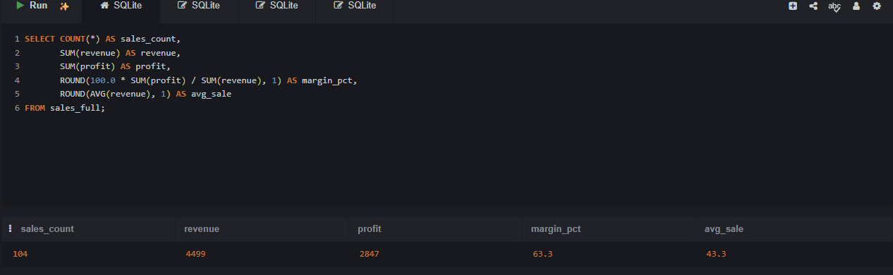
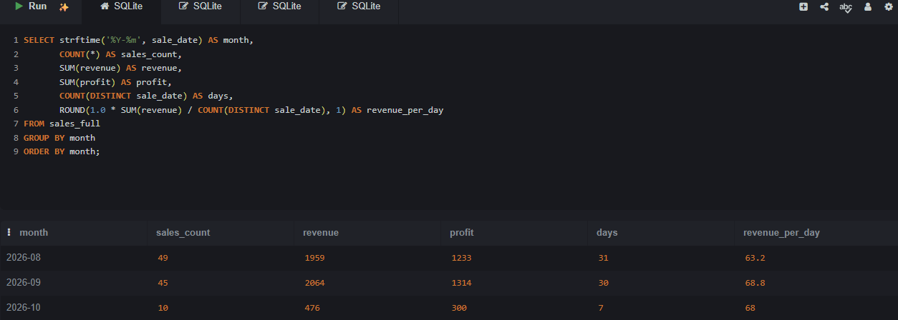
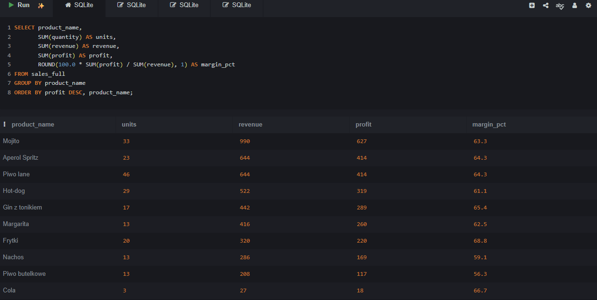
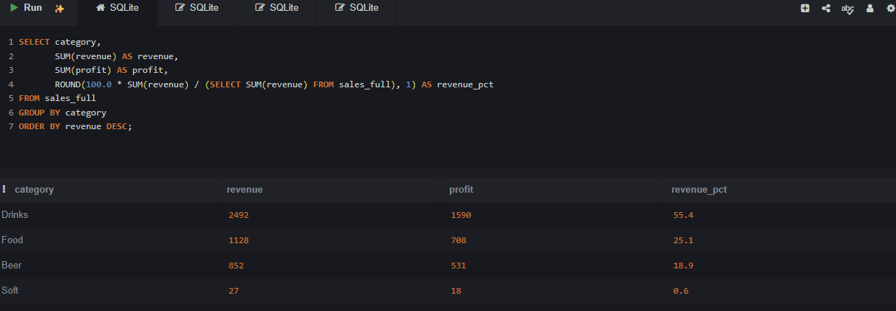
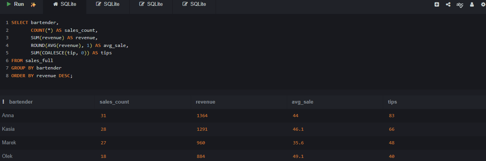
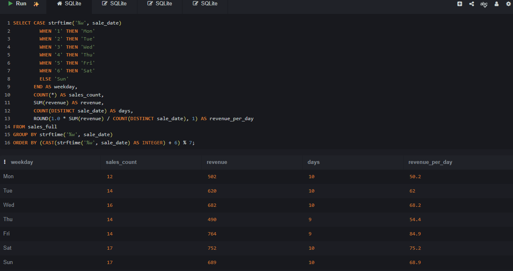
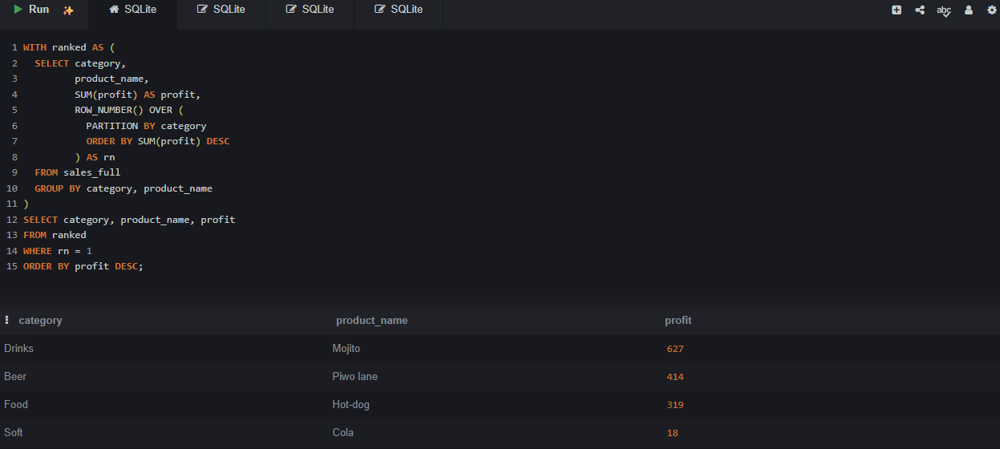

# Analiza sprzedaży baru — projekt SQL

**Autor:** Zoriana Kutsa · **Narzędzie:** SQLite · **Typ projektu:** projekt edukacyjny na danych przykładowych

> **In short (EN):** SQL analysis of a bar's sales (SQLite). I checked data quality (duplicates, missing values), joined three tables, answered 7 business questions with `JOIN`, `GROUP BY`, `CASE WHEN`, CTE and window functions, and wrote recommendations for the owner. The data is a sample dataset prepared for learning.

## Cel projektu

Odpowiedzieć na pytania właściciela baru: ile bar zarabia, które produkty i dni tygodnia są najbardziej opłacalne oraz co warto zmienić w ofercie i organizacji pracy. Projekt obejmuje cały proces analityczny: przygotowanie bazy, kontrolę jakości danych, analizę w SQL i wnioski biznesowe.

## Dane

Trzy powiązane tabele, okres od 1.08.2026 do 7.10.2026. Dane są przykładowe: przygotowano je do celów edukacyjnych na wzór prawdziwej struktury sprzedaży baru.

| Tabela | Zawartość | Liczba wierszy |
|---|---|---|
| `bar_sales` | pojedyncze sprzedaże (data, produkt, ilość, barman, napiwek) | 106 (104 po czyszczeniu) |
| `menu` | produkty z ceną i kosztem | 11 |
| `staff` | barmani i data zatrudnienia | 4 |

## Zakres umiejętności

- `SELECT`, `WHERE`, `ORDER BY`, `LIMIT`, `DISTINCT`
- agregacje i grupowanie: `COUNT`, `SUM`, `AVG`, `GROUP BY`, `HAVING`
- łączenie tabel: `INNER JOIN`, `LEFT JOIN`
- logika warunkowa i braki danych: `CASE WHEN`, `COALESCE`, `IS NULL`
- daty: `strftime`
- podzapytania i `WITH` (CTE), `VIEW`
- funkcje okna: `ROW_NUMBER() OVER (PARTITION BY ...)`
- zmiana danych: `CREATE TABLE AS`, `INSERT`, `DROP`

## Jakość danych

- W tabeli `bar_sales` znaleziono 2 zduplikowane sprzedaże (`sale_id` 21 i 62). Zostały usunięte w nowej tabeli `bar_sales_clean` (oryginał pozostał nietknięty), do analizy użyto 104 wierszy.
- W 29 sprzedażach (po czyszczeniu) brakuje napiwku (`NULL`). Wierszy nie usuwano, a w analizie napiwków braki zastąpiono zerem (`COALESCE`).
- Wszystkie sprzedaże mają odpowiadający produkt w `menu` i barmana w `staff`, ilości są poprawne.
- Produkt „Lemoniada” jest w menu, ale nie został sprzedany ani razu.

## Wyniki analizy

### 1. Ogólny obraz

| Sprzedaże | Przychód | Zysk | Marża | Średnia sprzedaż |
|---|---|---|---|---|
| 104 | 4499 zł | 2847 zł | 63,3% | 43,3 zł |

### 2. Zmiany w czasie

Październik jest niepełny (7 dni), dlatego porównujemy przychód dzienny.

| Miesiąc | Sprzedaże | Przychód | Zysk | Przychód dziennie |
|---|---|---|---|---|
| 2026-08 | 49 | 1959 | 1233 | 63,2 |
| 2026-09 | 45 | 2064 | 1314 | 68,8 |
| 2026-10 | 10 | 476 | 300 | 68,0 |

### 3. Produkty

| Produkt | Sztuki | Przychód | Zysk | Marża |
|---|---|---|---|---|
| Mojito | 33 | 990 | 627 | 63,3% |
| Aperol Spritz | 23 | 644 | 414 | 64,3% |
| Piwo lane | 46 | 644 | 414 | 64,3% |
| Hot-dog | 29 | 522 | 319 | 61,1% |
| Gin z tonikiem | 17 | 442 | 289 | 65,4% |
| Margarita | 13 | 416 | 260 | 62,5% |
| Frytki | 20 | 320 | 220 | 68,8% |
| Nachos | 13 | 286 | 169 | 59,1% |
| Piwo butelkowe | 13 | 208 | 117 | 56,3% |
| Cola | 3 | 27 | 18 | 66,7% |

### 4. Kategorie

| Kategoria | Przychód | Zysk | Udział w przychodzie |
|---|---|---|---|
| Drinks | 2492 | 1590 | 55,4% |
| Food | 1128 | 708 | 25,1% |
| Beer | 852 | 531 | 18,9% |
| Soft | 27 | 18 | 0,6% |

### 5. Barmani

| Barman | Sprzedaże | Przychód | Średnia sprzedaż | Napiwki |
|---|---|---|---|---|
| Anna | 31 | 1364 | 44,0 | 83 |
| Kasia | 28 | 1291 | 46,1 | 66 |
| Marek | 27 | 960 | 35,6 | 48 |
| Olek | 18 | 884 | 49,1 | 40 |

Olek pracuje od 20.08.2026, dlatego ma mniej sprzedaży niż pozostali.

### 6. Dni tygodnia

| Dzień | Sprzedaże | Przychód | Dni w okresie | Przychód dziennie |
|---|---|---|---|---|
| Pon | 12 | 502 | 10 | 50,2 |
| Wt | 14 | 620 | 10 | 62,0 |
| Śr | 16 | 682 | 10 | 68,2 |
| Czw | 14 | 490 | 9 | 54,4 |
| Pt | 14 | 764 | 9 | 84,9 |
| Sob | 17 | 752 | 10 | 75,2 |
| Niedz | 17 | 689 | 10 | 68,9 |

### 7. Najlepszy produkt w każdej kategorii (zysk)

| Kategoria | Produkt | Zysk |
|---|---|---|
| Drinks | Mojito | 627 |
| Beer | Piwo lane | 414 |
| Food | Hot-dog | 319 |
| Soft | Cola | 18 |

## Wnioski i rekomendacje

1. **Koktajle to fundament biznesu.** Kategoria Drinks daje 55% przychodu, a Mojito jest najbardziej zyskownym produktem. Warto eksponować koktajle w menu i promować Mojito oraz Aperol Spritz.
2. **Piątek i sobota są najmocniejsze, poniedziałek i czwartek najsłabsze.** Przychód dzienny wynosi 84,9 w piątek i 50,2 w poniedziałek. W mocne dni warto zwiększyć obsadę, a w słabe przetestować promocję (np. rabat na piwo) i sprawdzić jej wpływ.
3. **Piwo butelkowe i Nachos mają najniższe marże** (56,3% i 59,1% wobec 63,3% średnio). Warto sprawdzić koszty zakupu lub lekko podnieść ceny.
4. **Napoje bezalkoholowe prawie się nie sprzedają.** Dają 0,6% przychodu, Cola sprzedała się 3 razy, a Lemoniada ani razu. Do rozważenia: zmiana pozycji w menu lub ich wycofanie.
5. **Sprzedaż rośnie powoli.** Przychód dzienny wzrósł z 63,2 do 68,8, a w październiku utrzymuje się na poziomie 68,0. Trend wymaga dalszej obserwacji.
6. **Średnia wartość sprzedaży różni się między barmanami** (od 35,6 do 49,1). Przed wnioskami o osobach trzeba sprawdzić, czy pracują w podobne dni i zmiany, a następnie rozważyć wymianę dobrych praktyk w zespole.

## Ograniczenia

- krótki okres (10 tygodni) i niewielka próba (104 sprzedaże)
- październik jest niepełny
- brakuje napiwków w 29 sprzedażach
- brak godziny sprzedaży i liczby gości
- wnioski są hipotezami do sprawdzenia, a nie ostatecznymi ustaleniami

## Przykładowy kod

Najlepszy produkt w każdej kategorii (CTE + funkcja okna):

```sql
WITH ranked AS (
  SELECT category,
         product_name,
         SUM(profit) AS profit,
         ROW_NUMBER() OVER (
           PARTITION BY category
           ORDER BY SUM(profit) DESC
         ) AS rn
  FROM sales_full
  GROUP BY category, product_name
)
SELECT category, product_name, profit
FROM ranked
WHERE rn = 1
ORDER BY profit DESC;
```

## Zrzuty ekranu

| | |
|---|---|
|  |  |
|  |  |
|  |  |
|  | |

## Jak uruchomić projekt

1. Otwórz [sqliteonline.com](https://sqliteonline.com) i wybierz SQLite.
2. Skopiuj całą zawartość pliku `bar_project.sql` i wklej do edytora.
3. Kliknij **Run**. Skrypt utworzy wszystkie tabele i widok `sales_full`.
4. Aby zobaczyć wynik wybranego zapytania, wklej je osobno i uruchom ponownie.

## Struktura repozytorium

```
├── README.md
├── bar_project.sql       # pełny skrypt: tabele, czyszczenie, widok, 7 zapytań
└── screenshots/          # wyniki zapytań
```

## Dalsze kroki

- wizualizacja wyników w Power BI lub Excelu
- powtórzenie analizy na własnych, rzeczywistych danych
